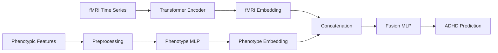

# ADHD-200 Multimodal Classification

## 01 · Project Overview

This project investigates binary ADHD classification using phenotypic and resting-state fMRI data from the [ADHD-200 dataset](https://fcon_1000.projects.nitrc.org/indi/adhd200/), accessed through NITRC.

The primary research question is whether combining fMRI representations with phenotypic features through intermediate fusion can improve classification performance over unimodal baselines.

The project includes phenotype-based machine learning models, a Transformer-based fMRI classifier, and a multimodal feature-level fusion framework.

## 02 · Model Architecture

The intermediate fusion architecture consists of two modality-specific encoders. A Transformer encoder learns representations from regional fMRI time series, while a multilayer perceptron (MLP) processes phenotypic features.

The resulting representations are concatenated and passed through a fusion MLP for binary ADHD classification.



Participants are matched across modalities using subject-level identifiers to ensure alignment between fMRI data, phenotypic features, and diagnostic labels.

Implementation: [intermediate_fusion.py](src/adhd200_multimodal/intermediate_fusion.py)

Configuration: [intermediate_fusion.yaml](configs/intermediate_fusion.yaml)

## 03 · Methods & Implementation

- **Frameworks:** PyTorch for neural networks; scikit-learn and XGBoost for phenotype-based machine learning.
- **Cross-validation:** Participant-level, stratified cross-validation with non-overlapping training and evaluation subjects.
- **Preprocessing:** Phenotypic feature imputation, encoding, and scaling are fitted within training folds to prevent data leakage.
- **Model training:** Neural models use an inner validation split for early stopping and model selection.
- **Evaluation:** Model discrimination is assessed using AUROC, with sensitivity, specificity, F1-score, Brier score, and calibration metrics reported as supplementary performance measures.

For matched-cohort comparisons, the multimodal model uses the same outer cross-validation splits as the corresponding unimodal models.

## 04 · Experimental Results

### Preliminary Model Evaluation

| Modality | Model | N | AUROC |
| :--- | :--- | ---: | ---: |
| Phenotype | Logistic Regression | 298 | 0.659 |
| Phenotype | XGBoost | 298 | 0.649 |
| fMRI | Transformer | 292 | 0.617 |

Results are based on cross-validation and should be interpreted as preliminary estimates. Because cohort sizes differ across modalities, direct performance comparisons are not appropriate.

Detailed evaluation metrics, including 95% confidence intervals, sensitivity, specificity, F1-score, and Brier score, are available in the corresponding experiment reports:

- [Logistic Regression](reports/phenotype_lr/metrics.json)
- [XGBoost](reports/phenotype_xgboost/metrics.json)
- [fMRI Transformer](reports/transformer/metrics.json)

## 05 · Limitations & Ongoing Work

- **Sample size:** The relatively small cohorts limit model training and the precision of performance estimates.
- **Site heterogeneity:** Differences in MRI acquisition protocols and participant characteristics may affect cross-site generalization.
- **Multimodal evaluation:** Ongoing experiments assess intermediate feature-level fusion against unimodal baselines using matched participants and consistent cross-validation splits.
- **Generalizability:** Independent external validation is needed before drawing conclusions about performance in new clinical populations.

This repository is an ongoing research project and is not intended for clinical diagnosis or screening.

---

<details>
<summary>Development, Data Interface & Reproducibility</summary>

### Environment and Checks

The project uses Python, PyTorch, scikit-learn, and XGBoost.

Install dependencies according to the repository configuration, then run:

```bash
pytest
ruff check .
```

### Data Interface

The multimodal workflow uses matched participant-level fMRI time series and phenotypic features.

Conceptual input shapes:

```text
fMRI time series: (N, T, R)
Phenotypic data: (N, P)
Diagnostic labels: (N,)
Subject identifiers: (N,)
```

Where:

- `N`: number of participants
- `T`: number of fMRI time points
- `R`: number of brain regions
- `P`: number of phenotypic features after preprocessing

The exact input keys, data paths, and preprocessing requirements are defined by the implementation and experiment configuration.

### Privacy and Reproducibility

Raw participant-level data and imaging files are not distributed through this repository.

Experiment configurations, random seeds, cross-validation procedures, and evaluation outputs are documented to support reproducibility.

</details>